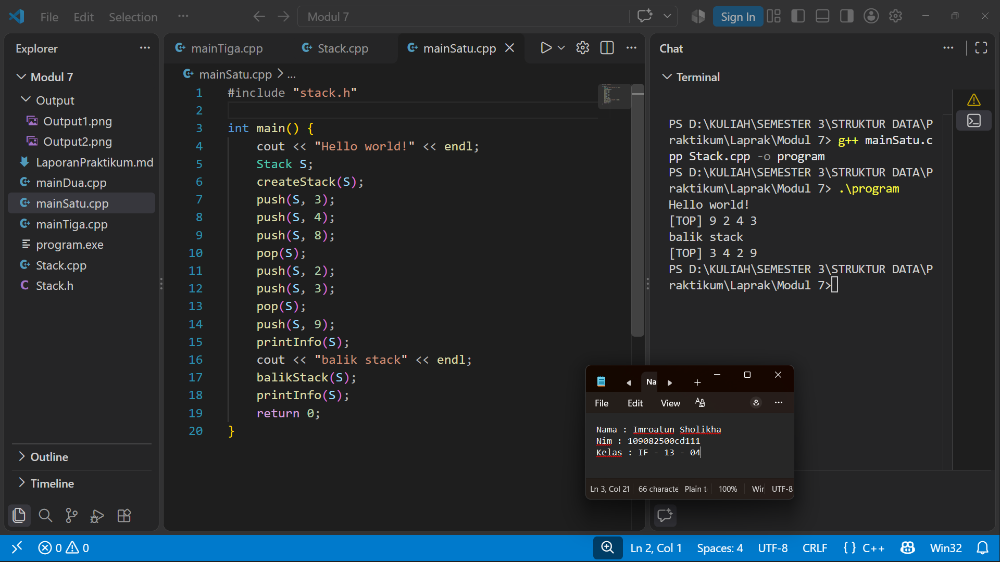
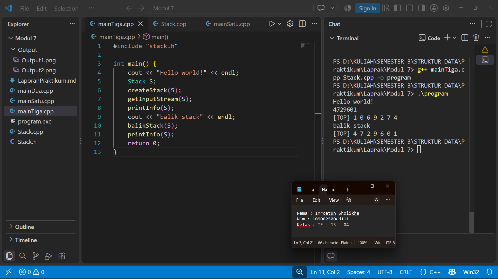

# <h1 align="center">Laporan Praktikum Modul 7 - STACK </h1>

<p align="center">Imroatun Sholikha - 109082500111</p>

## **Dasar Teori**

Stack merupakan salah satu struktur data yang menggunakan prinsip LIFO (*Last In First Out*), yaitu data yang terakhir masuk akan menjadi data pertama yang keluar. Stack memiliki elemen teratas yang disebut TOP sebagai tempat utama untuk menambahkan dan mengambil data. Operasi utama pada stack terdiri dari Push untuk menambahkan data dan Pop untuk menghapus atau mengambil data teratas. Stack dapat diimplementasikan menggunakan pointer maupun tabel (array), dengan kapasitas terbatas pada representasi tabel. [1][2]

**A. Push**

Push merupakan operasi untuk menambahkan elemen baru ke dalam stack. Penambahan data dilakukan pada posisi paling atas dengan menaikkan nilai TOP, kemudian menyimpan data pada posisi tersebut. Sebelum penambahan dilakukan, perlu diperiksa apakah stack sudah penuh agar kapasitasnya tidak terlampaui. [1][2]

**B. Pop**

Pop merupakan operasi untuk mengambil atau menghapus elemen teratas dari stack. Proses ini dilakukan dengan mengambil data pada posisi TOP, kemudian menurunkan nilai TOP satu tingkat. Operasi Pop hanya dapat dilakukan jika stack tidak dalam keadaan kosong. [1][2]


## Guided

### 1. 


## Stack.h

```C++

#ifndef STACK_TABLE
#define STACK_TABLE

#include <iostream>
using namespace std;

const int MAX = 10;

struct stackTable
{
    int dta[MAX];
    int top;
};

bool isEmpty(stackTable s);
bool isFull(stackTable s);
void createStack(stackTable &s);
void push(stackTable &s, int angka);
void pop(stackTable &s);
void update(stackTable &s, int posisi);
void view(stackTable s);
void searchData(stackTable s, int data);

#endif

```

## Stack.cpp

```C++

#include "stack.h"
#include <iostream>
using namespace std;

bool isEmpty(stackTable s)
{
    return s.top == -1;
}

bool isFull(stackTable s)
{
    return s.top == MAX - 1;
}

void createStack(stackTable &s)
{
    s.top = -1;
}

void push(stackTable &s, int angka)
{
    if (isFull(s))
    {
        cout << "Stack penuh!" << endl;
    }
    else
    {
        s.top++;
        s.dta[s.top] = angka;
        cout << "Data " << angka << " berhasil ditambahkan kedalam stack!" << endl;
    }
}

void pop(stackTable &s)
{
    if (isEmpty(s))
    {
        cout << "Stack kosong!" << endl;
    }
    else
    {
        int val = s.dta[s.top];
        s.top--;
        cout << "Data " << val << " berhasil dihapus dari stack!" << endl;
    }
}

void update(stackTable &s, int posisi)
{
    if (isEmpty(s))
    {
        cout << "Stack kosong!" << endl;
        return;
    }

    if (posisi <= 0)
    {
        cout << "Posisi tidak valid!" << endl;
        return;
    }

    int idx = s.top - (posisi - 1);

    if (idx < 0 || idx > s.top)
    {
        cout << "Posisi " << posisi << " tidak valid!" << endl;
        return;
    }

    cout << "Update data posisi ke-" << posisi << endl;
    cout << "Masukkan angka : ";
    cin >> s.dta[idx];

    cout << "Data berhasil diupdate!" << endl;
    cout << endl;
}

void view(stackTable s)
{
    if (isEmpty(s))
    {
        cout << "Stack kosong!" << endl;
    }
    else
    {
        for (int i = s.top; i >= 0; --i)
        {
            cout << s.dta[i] << " ";
        }
    }

    cout << endl;
}

void searchData(stackTable s, int data)
{
    if (isEmpty(s))
    {
        cout << "Stack kosong!" << endl;
        return;
    }

    cout << "Mencari data " << data << "..." << endl;

    int posisi = 1;
    bool found = false;

    for (int i = s.top; i >= 0; --i)
    {
        if (s.dta[i] == data)
        {
            cout << "Data " << data << " ditemukan pada posisi ke-" << posisi << endl;
            found = true;
            break;
        }

        posisi++;
    }

    if (!found)
    {
        cout << "Data " << data << " tidak ditemukan didalam stack!" << endl;
    }

    cout << endl;
}

```

## main.cpp

```C++
#include "stack.h"
#include <iostream>

using namespace std;

int main()
{
    stackTable s;
    createStack(s);

    push(s, 1);
    push(s, 2);
    push(s, 3);
    push(s, 4);
    push(s, 5);
    cout << endl;

    cout << "--- Stack setelah push ---" << endl;
    view(s);
    cout << endl;

    pop(s);
    pop(s);
    cout << endl;

    cout << "--- Stack setelah pop 2 kali ---" << endl;
    view(s);
    cout << endl;

    update(s, 2);
    update(s, 1);
    cout << endl;

    cout << "--- Stack setelah update ---" << endl;
    view(s);
    cout << endl;

    searchData(s, 4);
    searchData(s, 9);

    return 0;
}

```

## Unguided

### Buatlah ADT Stack menggunakan ARRAY sebagai berikut di dalam file “stack.h”:

## Stack.h

```C++

#ifndef STACK_H_INCLUDED
#define STACK_H_INCLUDED

#include <iostream>
using namespace std;

const int MAX = 20;
typedef int infotype;

struct Stack {
    infotype info[MAX];
    int top;
};

void createStack(Stack &S);
void push(Stack &S, infotype x);
infotype pop(Stack &S);
void printInfo(Stack S);
void balikStack(Stack &S);


void pushAscending(Stack &S, infotype x);
void getInputStream(Stack &S);

#endif 

```
File header berisi deklarasi tipe data dan prototipe semua prosedur/fungsi. Stack terdiri dari array info berkapasitas 20 dan top sebagai penunjuk elemen teratas. pop dibuat sebagai function yang mengembalikan infotype, sesuai soal. pushAscending dan getInputStream adalah tambahan untuk nomor 2 dan 3. 

## Stack.cpp

```C++

#include "stack.h"

void createStack(Stack &S) {
    S.top = -1;
}

void push(Stack &S, infotype x) {
    if (S.top < MAX - 1) {
        S.top++;
        S.info[S.top] = x;
    } else {
        cout << "Stack penuh!" << endl;
    }
}

infotype pop(Stack &S) {
    if (S.top >= 0) {
        infotype x = S.info[S.top];
        S.top--;
        return x;
    }
    cout << "Stack kosong!" << endl;
    return -1;
}

void printInfo(Stack S) {
    cout << "[TOP]";
    for (int i = S.top; i >= 0; i--) {
        cout << " " << S.info[i];
    }
    cout << endl;
}

void balikStack(Stack &S) {
    int kiri = 0, kanan = S.top;
    while (kiri < kanan) {
        infotype temp = S.info[kiri];
        S.info[kiri] = S.info[kanan];
        S.info[kanan] = temp;
        kiri++;
        kanan--;
    }
}

void pushAscending(Stack &S, infotype x) {
    if (S.top >= MAX - 1) {
        cout << "Stack penuh!" << endl;
        return;
    }
    int i = S.top;
    while (i >= 0 && S.info[i] > x) {
        S.info[i + 1] = S.info[i];
        i--;
    }
    S.info[i + 1] = x;
    S.top++;
}

void getInputStream(Stack &S) {
    char c;
    while ((c = cin.get()) != '\n') {
        if (c >= '0' && c <= '9') {
            push(S, c - '0');
        }
    }
}
```
Kode ini berisi implementasi dari prosedur yang telah dideklarasikan di stack.h. createStack mengatur stack agar kosong, push menambahkan data, dan pop menghapus data teratas. printInfo menampilkan isi stack dari atas ke bawah, balikStack membalik urutan elemen, sedangkan pushAscending menambahkan data secara terurut naik. Terakhir, getInputStream membaca input karakter angka dari pengguna, mengubahnya menjadi integer, lalu memasukkannya ke dalam stack.

## mainSatu.cpp

```C++
#include "stack.h"

int main() {
    cout << "Hello world!" << endl;
    Stack S;
    createStack(S);
    push(S, 3);
    push(S, 4);
    push(S, 8);
    pop(S);
    push(S, 2);
    push(S, 3);
    pop(S);
    push(S, 9);
    printInfo(S);
    cout << "balik stack" << endl;
    balikStack(S);
    printInfo(S);
    return 0;
}

```
Isi stack berubah seperti ini: [3,4,8], pop jadi [3,4], push 2 dan 3 jadi [3,4,2,3], pop jadi [3,4,2], push 9 jadi [3,4,2,9].

### Output Unguided 1 :

##### Output 1



### Tambahkan prosedur pushAscending( in/out S : Stack, in x : integer):

## mainDua.cpp

```C++
#include "stack.h"

int main() {
    cout << "Hello world!" << endl;
    Stack S;
    createStack(S);
    pushAscending(S, 3);
    pushAscending(S, 4);
    pushAscending(S, 8);
    pushAscending(S, 2);
    pushAscending(S, 3);
    pushAscending(S, 9);
    printInfo(S);
    cout << "balik stack" << endl;
    balikStack(S);
    printInfo(S);
    return 0;
}

```
Semua data dimasukkan dengan pushAscending, sehingga isi stack otomatis terurut menjadi 2 3 3 4 8 9 dari bawah ke atas.

### Output Unguided 2 :

##### Output 2


### Tambahkan prosedur getInputStream( in/out S : Stack ). Prosedur akan terus membaca dan
menerima input user dan memasukkan setiap input ke dalam stack hingga user menekan
tombol enter. Contoh: gunakan cin.get() untuk mendapatkan inputan user.

## mainTiga.cpp

```C++
#include "stack.h"

int main() {
    cout << "Hello world!" << endl;
    Stack S;
    createStack(S);
    getInputStream(S);
    printInfo(S);
    cout << "balik stack" << endl;
    balikStack(S);
    printInfo(S);
    return 0;
}

```
: Program menunggu user mengetik angka lalu menekan Enter. Angka pertama yang diketik berada paling bawah dan angka terakhir berada di [TOP]

### Output Unguided 3 :

##### Output 3



## Kesimpulan

Program Stack dapat digunakan untuk menambahkan, menghapus, menampilkan, dan membalik urutan data menggunakan prinsip LIFO (Last In First Out). Hasil pengujian menunjukkan bahwa operasi Push berhasil menambahkan data ke dalam stack, sedangkan Pop berhasil menghapus data teratas. Selain itu, operasi balikStack berhasil membalik urutan elemen sehingga susunan data pada stack menjadi terbalik dari sebelumnya.

## Referensi

[1] IsmyNR. (2018). *Contoh Program Stack C++ beserta Penjelasan dan Implementasinya (Tumpukan).* Coding IsmyNR. [Baca artikel](https://www.ismynr.xyz/2018/10/contoh-program-stack-c-penjelasan.html?utm_source=chatgpt.com).

[2] Fakultas Informatika, Telkom University. (2026). *Modul 7: Stack*. Modul Praktikum Struktur Data, hlm. 59–65.
